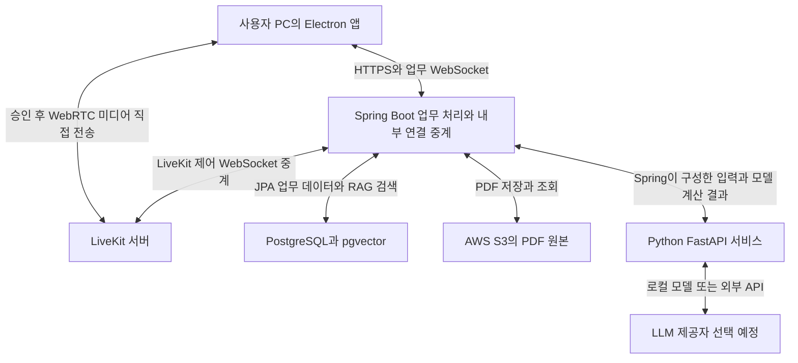
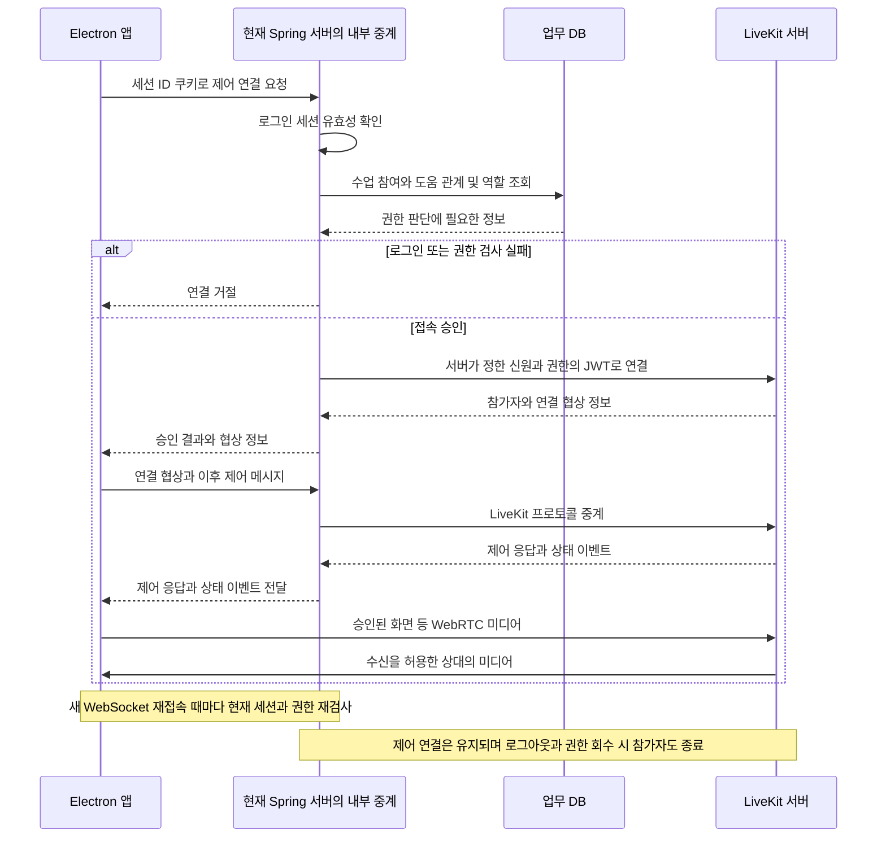
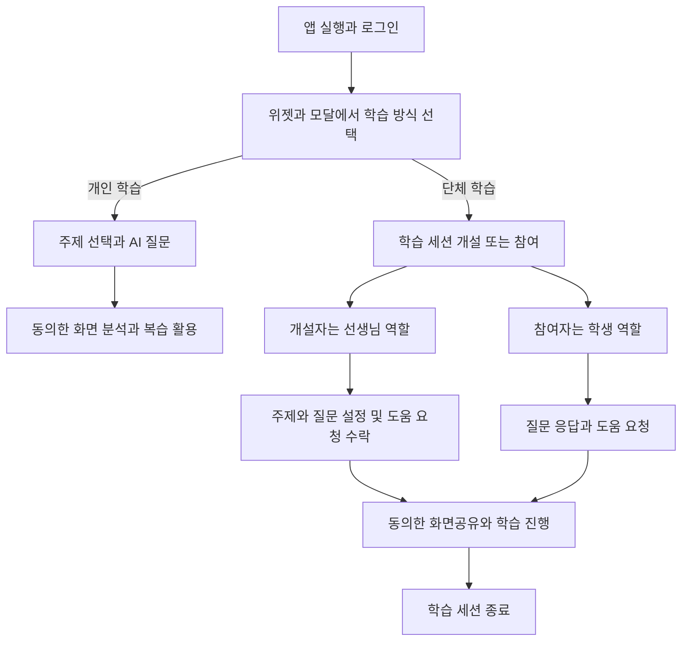
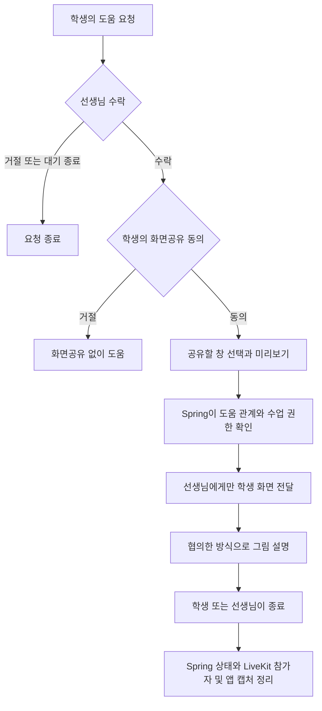

# TUTIPAL 프로젝트 설계서

> **문서 관리 기준**: 이 MD 파일이 설계서 원본이다. DOCX는 요청 시에만 변환한다. 2026-11-17 기본 골격 검증 후 PL 구현을 현재 구조에 이식했다. 이 문서의 정책을 유지하며 구체적인 이식·검증 결과는 DEVELOPMENT.md와 PORTING.md를 참고한다.

팀원 공통 이해와 구현 준비

2026년 11월 17일  |  새 설계본 1.4

**기본 개발환경 검증과 PL 업무 기능 이식을 진행했다. 외부 자격 증명·모델·미디어 환경이 필요한 기능의 실제 검증 여부는 개발 안내에서 구분한다.**

TUTIPAL은 혼자 공부하는 사용자와 함께 공부하는 학습 세션을 하나의 데스크톱 앱에서 지원한다. AI 도우미가 질문에 답하고, 세션을 개설한 사용자는 그 세션의 선생님이 되어 질문과 자료를 제공한다. 학생은 필요할 때 자신의 화면을 보여 주며 도움을 받을 수 있다.

### 이 설계의 중심 원칙

**모든 업무 요청과 실시간 연결의 접속 및 재접속 승인은 Spring Boot를 거친다. 승인된 연결의 음성, 영상, 화면 미디어 전송만 WebRTC 직접 통신을 허용한다.**

이 원칙은 앱이 스스로 권한을 판단하게 두지 않으면서, 계속 흐르는 화면 영상을 Spring이 대신 운반하는 부담을 줄이기 위한 것이다. LiveKit의 JWT 인증은 유지하고, Spring이 사용자와 수업에 맞는 권한을 결정한다.

### 읽고 나서 이해할 내용

- 화면을 내장한 Electron 앱, Spring이 판단하는 업무, LiveKit이 나르는 화면의 차이

- 로그인부터 학습, 화면공유, 도움 요청, 종료까지 사용자와 서버의 동작

- 확정한 정책과 팀 협의 또는 기술 검증이 필요한 항목의 구분

판서 방식, 공개 미디어 연결 방식, 인증 관문의 세부 구현은 뒤에서 미정 또는 검증 과제로 표시한다. 구현 완료나 성능 실측을 의미하는 항목은 없다.

## 문서 읽는 순서

처음 읽는 팀원은 1장부터 5장까지 먼저 읽고 전체 구조를 파악한다. 개발 환경은 20장의 버전 기준을 사용한다. 17장은 검증 도구 선택만 기록하며, 상세 테스트는 요구사항 확정 후 정한다.

- [1 서비스의 목적과 사용 모습](#1-서비스의-목적과-사용-모습)
- [2 확정한 방향과 남은 선택](#2-확정한-방향과-남은-선택)
- [3 구성 요소를 이해하는 기초](#3-구성-요소를-이해하는-기초)
- [4 전체 시스템 흐름](#4-전체-시스템-흐름)
- [5 통신 경로와 책임 분담](#5-통신-경로와-책임-분담)
- [6 Electron 데스크톱 앱](#6-electron-데스크톱-앱)
- [7 로그인과 권한 관리](#7-로그인과-권한-관리)
- [8 LiveKit 연결의 승인 과정](#8-livekit-연결의-승인-과정)
- [9 화면공유와 도움 요청](#9-화면공유와-도움-요청)
- [10 판서 기능의 선택과 데이터 경로](#10-판서-기능의-선택과-데이터-경로)
- [11 AI와 학습 지원 기능](#11-ai와-학습-지원-기능)
- [12 사용자 전체 흐름](#12-사용자-전체-흐름)
- [13 데이터와 개인정보 관리](#13-데이터와-개인정보-관리)
- [14 배포와 외부 연결](#14-배포와-외부-연결)
- [15 프로젝트 구조와 개발 규칙](#15-프로젝트-구조와-개발-규칙)
- [16 구현 순서와 완료 기준](#16-구현-순서와-완료-기준)
- [17 검증 도구와 적용 시점](#17-검증-도구와-적용-시점)
- [18 팀 협의와 기술 검증 항목](#18-팀-협의와-기술-검증-항목)
- [19 용어를 다시 확인하기](#19-용어를-다시-확인하기)
- [20 개발 환경과 버전 기준](#20-개발-환경과-버전-기준)
- [21 기본 프로젝트 골격과 현재 상태](#21-기본-프로젝트-골격과-현재-상태)
- [참고자료](#참고자료)

**문서에서 사용하는 상태**

| 표시 | 뜻 |
| --- | --- |
| 확정 | 이번 설계에서 따르기로 한 방향이다. 구현이 끝났다는 뜻은 아니다. |
| 제안 | 개발을 시작할 수 있도록 제시한 초안이며 팀에서 조정할 수 있다. |
| 미정 | 팀 협의가 필요한 기능이나 운영 수치이다. |
| 검증 필요 | 정책은 정했지만 실제 SDK와 배포 환경에서 확인해야 한다. |

## 1 서비스의 목적과 사용 모습

TUTIPAL의 핵심은 개인 학습과 단체 학습을 자연스럽게 연결하는 것이다. 사용자는 코딩, 영어, 수학 같은 주제를 선택해 AI에게 질문할 수 있고, 단체 세션에서는 선생님이 정한 학습 주제에 맞춰 학습한다.

### 계정과 수업 역할

모든 사용자는 같은 Electron 앱을 사용한다. 계정의 일반 사용자와 관리자 구분은 서비스 관리용이다. 선생님과 학생은 계정에 영구적으로 붙는 직업 구분이 아니라 특정 학습 세션 안에서 정해지는 역할이다.

| 상황 | 해당 세션에서의 역할 | 할 수 있는 일 |
| --- | --- | --- |
| 사용자가 세션 개설 | 선생님 | 학습 주제 설정, 질문 전송, 도움 요청 수락, 화면공유 |
| 다른 사용자의 세션 참여 | 학생 | 질문 응답, 자료 열람, AI 질문, 도움 요청 |
| 다른 세션에도 참여 | 세션별로 별도 판단 | 한 사람도 세션 A에서는 선생님, 세션 B에서는 학생일 수 있다. |

### 대표적인 사용 예

코딩 세션의 선생님이 반복문을 설명하고 이해도 질문을 보낸다. 학생은 답을 제출하고, 이해되지 않는 부분은 AI 도우미에게 질문한다. 해결되지 않으면 선생님에게 도움을 요청한다. 선생님이 수락하고 학생이 공유할 창을 선택하면, 선생님이 그 화면을 보며 설명한다.

### 제공 범위

- 개인 학습과 AI 대화, 현재 화면에 관한 질문, 동의 기반 화면 요약과 복습 제안

- 단체 세션 개설과 참여, 학습 주제 적용, 이해도 질문과 결과 확인

- 자료와 공지 및 게시판, 선생님 화면공유, 학생의 개별 도움 요청

- 그림 설명 기능을 제공하는 방향은 유지하되, 실제 판서 화면과 동작 방식은 미정

실시간 수업 녹화와 외부 방송 송출은 제공하지 않는다. 따라서 이번 구성에는 LiveKit Egress를 포함하지 않는다.

## 2 확정한 방향과 남은 선택

| 영역 | 설계 방향 | 상태 |
| --- | --- | --- |
| 앱 | JavaScript 기반 React + Vite 화면을 내장한 동일한 Electron 앱 사용 | 확정 |
| 업무 처리 | Spring Boot가 사용자 인증과 수업 권한 및 업무 규칙을 판단 | 확정 |
| 로그인 | Electron이 세션 ID 쿠키를 보관·전송하고 Spring이 로그인 세션 확인 | 확정 |
| LiveKit 제어 | 현재 Spring Boot 서버 내부에서 최초 접속과 재접속을 인증하고 WebSocket 중계 | 확정 |
| LiveKit 데이터 권한 | 모든 참가자에게 canPublishData=false를 명시하고 업무 데이터는 Spring 경유 | 확정 |
| 인증 상태 유실 | Spring 장애로 연결 매핑 또는 로그인 상태를 잃으면 LiveKit 연결 해제 후 재인증 | 확정 |
| 미디어 전송 | 승인된 Electron과 LiveKit 사이에서 WebRTC로 전송 | 확정 |
| LiveKit JWT | 기본 인증 유지, 사용자와 방 및 권한은 Spring에서 결정 | 확정 |
| 갱신 토큰 | LiveKit 자체 갱신 토큰이 있어도 관문의 Spring 세션 검사를 우회하지 못하게 함 | 확정 |
| 일회용 LiveKit 토큰 | 별도 일회용 소비 방식은 채택하지 않음 | 확정 |
| AI 요청 경로 | Spring을 거쳐 내부 FastAPI 호출, 로컬 LLM 또는 외부 API 선택은 논의 | 경로 확정 |
| RAG | 자료 권한 검사, 인덱싱, 검색과 컨텍스트 구성은 Spring만 수행 | 확정 |
| PDF 원본 | AWS S3에 저장하고 S3 주소와 객체 식별정보를 PostgreSQL에 기록 | 확정 |
| 녹화와 방송 | 지원 범위에서 제외하며 Egress를 배포하지 않음 | 확정 |

### 제품 기능에서 남은 선택

학생 화면 위에 직접 표시할지, 별도 공동 칠판을 쓸지, 선생님 그림판을 화면공유할지는 팀에서 협의한다. 음성 통화와 카메라 사용 여부, 복습을 제안하는 기준, 도움 요청의 동시 처리 수와 운영 시간 제한도 아직 정해야 한다.

### 구현 전에 확인할 항목

중계는 현재 Spring Boot 서버 내부에 구현한다. 내부 중계 컴포넌트와 표준 SDK의 토큰 인자, 사전 HTTP 요청 및 재접속 처리를 연결하는 세부 동작은 기술 검증이 필요하다. 배치 위치의 결정과 구현 동작 검증은 구분한다.

## 3 구성 요소를 이해하는 기초

각 기술은 서로 다른 문제를 해결한다. 이름이 비슷한 세션이나 토큰도 같은 대상을 뜻하지 않으므로 역할부터 구분한다.

| 구성 요소 | 쉬운 설명 | TUTIPAL에서의 역할 |
| --- | --- | --- |
| Electron 앱 | JavaScript 기반 React + Vite 화면을 내장한 데스크톱 클라이언트 | 로그인과 학습 화면, API와 SDK 호출, 캡처, 창과 위젯 |
| Spring Boot | 요청을 받아 인증과 업무 규칙을 처리하는 서버 | 로그인과 권한, LiveKit 중계, JPA와 RAG, S3 파일 관리 |
| LiveKit 서버 | 실시간 미디어를 참가자에게 전달하는 서버 | 공유 화면과 선택한 음성 및 영상 전송 |
| LiveKit SDK | 앱과 서버에서 LiveKit 기능을 호출하는 라이브러리 | 앱의 접속과 송수신 / Spring의 방과 참가자 관리 |
| FastAPI 서비스 | Spring이 지정한 입력으로 모델 계산과 외부 API 호출 수행 | 답변 생성, 이미지 분석, 임베딩 계산과 채점 초안 |
| PostgreSQL | 업무 데이터를 저장하는 데이터베이스 | 계정, 수업, 질문, 자료, 요약 및 검색 벡터 |
| AWS S3 | PDF 원본을 저장하는 외부 객체 저장소 | Spring이 파일을 저장·조회하고 DB에는 저장 위치 기록 |

Electron 앱의 화면은 JavaScript와 JSX로 작성하고 Vite로 개발·빌드한다. React 화면은 앱 내부에 포함되므로 시스템 흐름도에서는 Electron 앱 하나로 표시한다.

LiveKit 서버 자체는 Go로 작성되어 있지만, 팀은 Electron 앱에서 JavaScript SDK를, Spring에서 Java와 호환되는 서버 SDK를 사용한다. LiveKit 서버를 직접 수정하지 않는 이번 방향에서는 Go로 앱 기능을 만들 필요가 없다. [2][3]

SDK를 앱에 설치하는 것과 LiveKit 서버를 실행하는 것은 별개의 작업이다. 앱에 SDK만 넣어도 서로의 화면이 자동으로 연결되는 것은 아니다.

## 4 전체 시스템 흐름

그림 1 전체 시스템 구성과 통신 경로

각 선의 라벨로 업무 요청, 연결 제어, 미디어 및 데이터 저장 경로를 구분한다. React 화면은 Electron 앱 내부에 포함한다. LLM 제공자는 로컬 모델 또는 외부 API 중 선택하며 아직 확정하지 않았다.

Electron 앱은 내장한 화면을 실행하고 외부 업무 요청을 Spring으로 보낸다. Spring은 로그인 세션과 업무 DB를 확인하고, 필요할 때 내부 AI 서비스 또는 LiveKit 관리 API를 호출한다.

화면공유의 영상은 Spring을 지나지 않는다. 승인된 참가자의 WebRTC 연결로 LiveKit에 도착하고, LiveKit이 허용된 상대에게 전달한다. RAG 자료 조회와 S3 파일 접근은 Spring만 수행한다. Python 서비스는 DB나 S3를 직접 조회하지 않는다.

## 5 통신 경로와 책임 분담

| 통신 종류 | 사용 경로 | 확인할 권한 |
| --- | --- | --- |
| 일반 업무 API | Electron → Spring → DB 또는 내부 서비스 | 로그인, 수업 참여, 해당 작업의 역할과 소유권 |
| RAG | Electron → Spring → pgvector 검색 → Spring의 컨텍스트 구성 → FastAPI의 모델 호출 | 자료 열람 권한, 수업 범위, 개인 기록 소유권 |
| PDF 업로드와 열람 | Electron ↔ Spring ↔ S3 / DB에는 S3 저장 위치 기록 | 업로드·열람·삭제 권한과 수업 범위 |
| AI 답변 | Electron → Spring → FastAPI → 선택한 LLM / 답변은 Spring을 통해 SSE로 반환 | 사용자와 수업 범위, 입력 크기, 동시 요청 제한 |
| 업무 알림 | Electron ↔ Spring의 STOMP WebSocket | 세션 인증, 송신 동작, 수신할 수업과 사용자 |
| LiveKit 제어 | Electron ↔ 현재 Spring 서버의 내부 중계 ↔ LiveKit | 접속 및 재접속 승인, 사용자와 방의 결합 |
| 화면과 음성 및 영상 | Electron ↔ LiveKit의 WebRTC / 필요 시 TURN을 경유 | 승인된 참가자와 트랙 송수신 권한 |
| 판서 좌표 등 업무 데이터 | 좌표 공유형을 선택하면 Spring 업무 WebSocket 사용을 기본으로 설계 | 수업, 도움 요청 상대, 송신자 역할, 데이터 범위 |

### 서로 다른 두 WebSocket

STOMP WebSocket은 질문 도착과 도움 요청 같은 앱의 업무 이벤트를 처리한다. LiveKit WebSocket은 영상 연결 협상과 트랙 제어에 쓰이는 LiveKit 전용 프로토콜이다. 둘 다 Spring을 거치지만 하나의 STOMP 연결로 합치는 것은 아니다. LiveKit 메시지는 그대로 호환되게 중계해야 한다. [4]

### 중계와 업무 권한 검사

관문을 지났다는 사실만으로 모든 동작을 허용하지 않는다. Spring은 업무 명령마다 수업 역할과 대상 사용자를 검사한다. LiveKit의 전송 및 수신 권한은 JWT와 참가자 권한으로 추가 집행한다. LiveKit 프로토콜을 단순 전달하는 관문이 메시지별 업무 규칙까지 자동으로 검사해 주는 것은 아니다.

LiveKit JWT 발급과 참가자 권한 설정 및 변경에서 모든 참가자에게 canPublishData=false를 명시한다. 미디어 발행을 허용해도 데이터 전송 권한은 별도로 차단하며, 토큰 갱신 과정에서도 이 제한을 유지한다. 판서 좌표를 포함한 업무 데이터는 Spring 경로만 사용한다. [38]

## 6 Electron 데스크톱 앱

### 화면을 내장한 하나의 앱

TUTIPAL의 Electron 앱에는 JavaScript 기반 React + Vite 화면을 반드시 내장한다. 사용자는 설치한 앱 안에서 로그인과 학습 화면을 이용한다. 아래 구분은 하나의 앱 내부 구조이며, 각각 별도 클라이언트나 서버로 동작한다는 뜻이 아니다.

| 부분 | 담당 역할 | 허용 범위 |
| --- | --- | --- |
| Main 프로세스 | 창, 트레이, 캡처 대상 선택과 PC 기능 관리 | 필요한 기능만 수행하고 입력 및 호출 출처 검사 |
| Preload | 화면과 PC 기능 사이의 제한된 통로 | 구체적인 기능만 공개하고 임의 파일 접근이나 명령 실행 금지 |
| Renderer | 내장한 React 화면과 UI 상태, API 및 SDK 호출 | 일반 Node.js 권한을 부여하지 않음 |

### 내장 화면과 빌드

화면은 JavaScript와 JSX로 작성한다. Vite는 개발 서버와 화면 빌드를 담당한다. 개발 중에는 Vite 개발 서버를 사용할 수 있지만, 배포할 때는 빌드한 HTML, CSS, JavaScript와 정적 파일을 Electron 패키지에 포함한다. Spring은 로그인과 업무 API를 제공한다.

내장 화면과 Spring 서버가 같은 출처라는 전제를 두지 않는다. API, SSE, 업무 WebSocket과 LiveKit 관문에서 동일한 로그인 쿠키가 전달되도록 연결 방식을 검증한다. 로컬 화면의 출처와 CORS, 쿠키 및 WebSocket 출처 검사를 함께 확인한다. [1][5][15]

### 창 구성

- 앱 UI는 작은 위젯과 기능별 모달로 구성한다. 로그인, 학습 세션, AI 질문과 선생님 기능도 해당 모달에서 제공한다. 별도 웹사이트형 메인 화면은 두지 않는다.

- 캐릭터 위젯은 화면 요약과 질문 진입 기능을 제공한다. 표시와 일시정지는 사용자가 제어한다.

- 판서 오버레이가 필요할지는 판서 방식 결정 후 정한다. 트레이는 앱 열기와 종료 등만 담당한다.

### 보안과 배포

contextIsolation과 sandbox를 사용하고 nodeIntegration을 끈다. 내장 화면의 로딩과 IPC 호출을 제한하고 필요한 캡처 권한만 동의받는다. 수업 권한이나 채점 결과는 앱의 판단만으로 확정하지 않는다. [1][8]

Vite 화면 빌드 후 Electron 패키징으로 연결하며 한 명령으로 묶을 수 있다. Windows는 exe 또는 msi, macOS는 app과 dmg 등 OS별 결과물을 만든다. 지원 OS와 서명 및 업데이트 방식은 배포 전에 확정한다.

## 7 로그인과 권한 관리

### 로그인 세션과 학습 세션

로그인 세션은 Spring이 관리하는 사용자 인증 상태이다. Electron은 Spring이 발급한 로그인 세션 ID를 쿠키로 보관하고 요청에 보낸다. Spring은 그 ID에 대응하는 유효한 세션을 찾아 인증한다. 이 로그인 쿠키에 LiveKit JWT를 저장하는 구조가 아니다.

학습 세션은 선생님과 학생이 함께 참여하는 수업 공간이며, LiveKit 참가자 세션은 실제 미디어 연결의 상태이다. 로그인 세션과 이 둘은 연결해서 관리하되 같은 것으로 취급하지 않는다.

### 로그인 사용자 흐름

1. 사용자가 앱에서 카카오, 네이버 또는 구글 로그인을 선택한다. 지원할 공급자와 앱 등록 설정은 구현 전에 확인한다.

2. Spring이 소셜 로그인 과정을 처리하고 계정을 식별한다. 시스템 브라우저를 사용하는 흐름을 기본 제안으로 두고, 공급자의 앱 정책에 맞춘다.

3. 외부 브라우저에서 앱으로 돌아올 때는 짧은 일회용 연결 코드를 사용할 수 있다. 이 코드는 소셜 로그인 결과를 앱에 연결하기 위한 것이며 LiveKit 토큰과 다르다.

4. 앱이 연결 코드를 Spring에 전달하면 Spring이 검증하고 로그인 세션 쿠키를 설정한다. 코드의 일회용 소비와 요청을 시작한 앱과의 결합도 검사한다.

5. 이후 업무 API와 WebSocket 접속에 같은 세션 쿠키를 전송한다. 여러 창과 네트워크 호출은 필요한 범위에서 같은 Electron 세션 저장 영역을 사용한다. 이는 서버의 로그인 세션 저장소와 구분한다. [11]

### 서버가 결정하는 권한

사용자는 로그인되어 있어도 모든 수업에 들어갈 수 없다. Spring은 학습 세션 참여 관계, 세션별 선생님 여부, 도움 요청 수락 상태를 DB에서 확인한다. 앱이 보낸 USER ID, TEACHER 표시나 방 이름을 그대로 신뢰하지 않는다.

### 세션 쿠키와 만료

HttpOnly, Secure와 HTTPS를 적용하고, 내장 화면의 요청 경로에 맞는 SameSite와 쿠키 전송 설정을 검증한다. 상태 변경 요청에는 CSRF 방어를 두고 WebSocket 접속 출처도 검사한다. 세션 쿠키 방식은 확정이며 별도 외부 세션 저장소 도입을 전제하지 않는다. [5][11][15]

유휴 시간과 절대 로그인 시간은 미정이다. 수업 중의 사용자 활동을 어떻게 판단할지도 정해야 한다. 화면을 보기만 하는 학생을 부당하게 로그아웃시키지 않으면서 무기한 로그인을 방지하는 기준이 필요하다.

## 8 LiveKit 연결의 승인 과정

목표는 앱이 유효한 LiveKit JWT를 가지고 있더라도 Spring의 현재 로그인 상태와 수업 권한 검사를 통과해야 연결할 수 있게 하는 것이다. 아래는 구현할 목표 흐름이다.

그림 2 Spring 승인과 LiveKit 연결 협상 흐름

Spring은 먼저 로그인 세션과 수업 권한을 검사하고, 승인한 사용자와 방 및 권한으로 LiveKit JWT를 준비한다. 중계 컴포넌트는 같은 Spring 애플리케이션 내부에서 이 판단을 사용한다.

이후 LiveKit 전용 연결 협상과 제어 메시지를 중계한다. 승인 후 WebRTC 미디어 전송은 Spring을 통과하지 않는다. 이 구분은 WebSocket과 WebRTC를 별도로 사용하는 LiveKit의 구조를 따른다. [3][4]

### 8.1 연결 관문과 JWT의 연동 상세

#### Spring 관문의 동작

관문은 LiveKit 제어용 WebSocket을 받기 전에 세션 쿠키와 요청 출처를 확인한다. 이어서 해당 사용자의 수업 참여와 도움 요청 승인 여부를 검사한다. 실패하면 LiveKit 연결을 만들지 않는다.

승인하면 Spring이 사용자, 방, 송신 및 수신 권한을 확정하고 내부 LiveKit 접속에 사용할 JWT를 준비한다. canPublishData=false를 항상 포함한다. 외부에서 보낸 임의 JWT나 사용자 헤더가 서버의 결정을 덮어쓰지 못하게 한다. 재접속 요청도 같은 검사를 거친다.

#### JWT를 유지하는 이유

LiveKit은 JWT를 이용해 참가자의 신원과 권한을 얻는다. 이번 설계에서는 이 기본 인증을 유지한다. 별도의 일회용 LiveKit 토큰 소비 장부는 만들지 않으며, 보안 통제의 중심은 Spring 관문의 강제 통과와 서버의 권한 결정이다. [3][9]

LiveKit 서버는 재접속용 토큰을 갱신할 수 있다. 앱이 갱신 토큰을 수신하더라도 그 토큰만으로 관문 밖에서 제어 연결을 만들 수 없어야 한다. JWT가 앱에 절대로 노출되지 않는다고 가정하지 않는다. API Secret은 항상 서버에만 둔다.

#### 현재 Spring 서버 내부에 중계 구현

LiveKit 제어용 WebSocket 중계는 기존 Spring Boot 애플리케이션 내부의 전용 컴포넌트로 구현한다. 별도 Gateway 서버를 배포하지 않으며 Spring Cloud Gateway WebFlux 스타터도 도입하지 않는다. 여기서 관문은 현재 Spring 서버 안의 인증과 연결 승인 역할을 뜻한다.

내부 중계 컴포넌트는 기존 Spring Security의 로그인 세션 확인과 업무 Service의 수업 권한 검사를 사용한다. Electron과 LiveKit 사이의 전용 WebSocket 메시지를 양방향으로 전달하고, 연결 매핑과 종료를 관리한다. 업무 알림용 STOMP 연결과 합치지 않으며 중계 컴포넌트 자체가 WebRTC 참가자가 되는 것도 아니다. [5][6]

표준 SDK의 접속 함수는 토큰 인자를 받는다. 쿠키 기반 관문과 서버 측 JWT 주입을 연결할 때 SDK가 수행하는 사전 확인, WebSocket 생성, 재접속, 방 이동까지 확인해야 한다. 단순 주소 변경만으로 끝난다고 전제하지 않는다. [7]

| 검증 항목 | 통과 조건 |
| --- | --- |
| 정상 접속 | 앱의 세션과 수업 권한으로 올바른 LiveKit 참가자가 생성됨 |
| 신원 위조 | 앱에서 사용자나 방 및 JWT를 바꿔도 서버가 승인한 범위를 넘지 못함 |
| 우회 접속 | 유효한 JWT만 들고 LiveKit 제어용 원본 주소에 직접 접근할 수 없음 |
| 재접속 | 갱신 토큰이 있어도 현재 Spring 세션과 수업 권한을 다시 검사함 |

### 8.2 재접속과 종료의 처리

#### 연결이 계속 유지되는 동안

LiveKit은 참가자 객체에 신원과 권한, 연결과 트랙 상태를 보관한다. 미디어 프레임마다 Spring에 로그인 확인 요청을 보내지는 않는다. LiveKit 토큰 만료도 이미 연결된 참가자를 자동으로 내보내는 수업 종료 수단이 아니다. [3][10]

#### 연결이 일시적으로 끊긴 경우

새 WebSocket을 여는 재접속은 반드시 Spring 관문을 다시 지난다. 원래 참가자를 복구하는 경우에도 같은 사용자와 수업 관계인지 검사한다. WebSocket은 유지되고 미디어 경로만 복구하는 ICE 재협상은 새 로그인과 구분하며, 이미 승인한 참가자 상태와 서버의 현재 권한 아래에서 처리한다.

자동 재접속 시 화면공유를 조용히 다시 시작할지는 별도 동의 정책이 필요하다. 명시적 중지나 로그아웃 후에는 자동으로 캡처를 재개하지 않는다. 연결 실패와 권한 거절을 화면에서 구분한다.

#### 로그아웃과 권한 회수

1. Spring이 로그인 세션, 수업 참여 권한 또는 도움 요청 권한의 종료를 기록한다.

2. 해당 로그인 세션과 연결된 LiveKit 방, 참가자, 연결 식별자를 찾는다.

3. 신규 연결과 재접속을 먼저 거부하고, LiveKit 관리 API로 해당 참가자를 종료하거나 권한을 회수한다.

4. 업무 WebSocket과 LiveKit 제어용 연결을 정리하고 앱에 상태를 알린다.

5. 앱이 캡처 트랙, 위젯의 공유 표시, 필요 시 판서 오버레이를 정리한다.

6. LiveKit 종료 요청이 실패하면 재시도하고 남은 참가자를 점검한다. 앱의 종료 알림만 믿고 완료 처리하지 않는다.

로그인 세션과 WebSocket 및 LiveKit 참가자의 연결 관계를 Spring에서 추적한다. 로그인 세션의 만료만으로 LiveKit 참가자까지 자동 종료된다고 가정하지 않는다. 만료 감지와 종료 실패를 포함한 최대 차단 지연은 구현 전에 정하고 검증한다.

#### Spring 장애로 인증 상태 또는 연결 매핑을 잃은 경우

Spring 장애로 연결 매핑이나 로그인 상태 중 하나라도 잃으면 해당 LiveKit 연결의 기존 접속 승인을 폐기한다. 기존 JWT만으로 복구하지 않으며 LiveKit 연결을 해제한 뒤 다시 로그인 인증과 수업 권한 검사를 받아 연결한다. 로그인 상태가 남아 있어도 연결 매핑 유실로 정리한 연결에는 재인증이 필요하다.

1. 상태 유실을 감지하면 영향받은 연결의 신규 접속과 재접속 승인을 차단한다.

2. 연결 정보가 남아 있으면 해당 참가자를 즉시 종료한다. 매핑을 잃었으면 Spring 복구 시 서비스가 관리하는 LiveKit 방과 참가자 목록을 조회해 현재 인증 및 연결 관계를 확인할 수 없는 참가자를 종료한다.

3. 참가자 종료와 캡처 정리를 완료한 뒤 앱에 재인증을 안내한다. 정리에 실패한 대상은 재시도하고, 정리되지 않은 연결을 정상 복구된 것으로 승인하지 않는다.

4. 사용자가 다시 인증하면 새로운 연결 식별자와 권한으로 접속한다. 화면공유를 다시 시작할 때는 공유 대상과 동의를 다시 확인한다.

Spring 프로세스가 완전히 중지된 동안에는 Spring에서 관리 API를 호출할 수 없다. 중계 제어 연결의 장애 감지와 LiveKit의 연결 정리 동작을 확인하고, Spring 복구 시 남은 참가자를 다시 대조·정리한다. 장애 발생부터 실제 해제까지의 최대 허용 지연과 재시도 간격은 기술 검증에서 정한다. 별도 세션 저장소나 별도 Gateway 도입을 전제하지 않는다.

## 9 화면공유와 도움 요청

### 수업 전체 공유와 개별 도움의 분리

선생님이 자신의 화면을 전체 학생에게 보여 주는 공간과, 특정 학생이 선생님에게만 화면을 보여 주는 공간을 분리한다. 방 이름을 복잡하게 만드는 것만으로 접근을 통제하지 않고, Spring이 관리하는 공유 관계와 LiveKit 권한을 함께 사용한다.

| 공유 공간 | 참가자 | 기본 송신 권한 | 기본 수신 범위 |
| --- | --- | --- | --- |
| 수업 전체 공유 A | 해당 세션 선생님 | 선택한 자신의 화면 | 필요한 수업 트랙 |
| 수업 전체 공유 A | 해당 세션 학생 | 화면 송신 불가 | 선생님의 공유 화면 |
| 개별 도움 B | 도움을 요청한 학생 | 동의한 자신의 화면 | 선택한 기능에 필요한 범위 |
| 개별 도움 B | 수락한 해당 선생님 | 통화 등 채택한 기능만 | 그 학생의 공유 화면 |
| 개별 도움 B | 다른 학생 또는 다른 선생님 | 입장 불가 | 수신 불가 |

음성 통화와 카메라는 채택 여부를 정한 뒤 위 권한표에 추가한다. 숨김 참가자 기능은 UI 표시 방식일 뿐 접근 통제 수단으로 사용하지 않는다. LiveKit이 제공하는 송신 소스와 수신 권한을 사용하되, 필요한 트랙 제한이 실제로 집행되는지도 확인한다. [3]

위 표의 모든 역할에 canPublishData=false를 적용한다. 참가자에게 화면 송신 권한이 있어도 LiveKit 데이터 전송 권한을 함께 부여하지 않는다. 이 제한은 최초 JWT와 서버의 권한 변경 및 갱신 토큰 모두에서 유지한다.

### 학생의 화면 선택

선생님이 도움 요청을 수락했다는 사실만으로 학생 화면을 캡처하지 않는다. 학생이 공유 여부를 결정하고, 창 또는 화면을 선택하고, 미리보기를 확인한 뒤 시작한다. 학생에게 공유 중인 대상과 중지 버튼을 계속 보여 준다.

### 도움 요청의 상태

요청은 대기, 수락, 거절, 취소, 진행, 종료 상태로 구분하는 안을 제안한다. 동시에 수락과 취소가 들어오면 Spring이 하나의 유효한 상태 전이만 허용한다. 동시 도움 수, 대기 시간, 동일 학생 중복 요청 기준은 미정이다.

## 10 판서 기능의 선택과 데이터 경로

그림 설명 기능을 넣는 방향은 유지한다. 다만 실제 화면 위에 표시할지, 공동 칠판을 만들지 등 제품 동작은 팀 협의 전이므로 확정하지 않는다.

| 선택지 | 사용자가 보는 모습 | 추가로 필요한 처리 |
| --- | --- | --- |
| 선생님 그림판 공유 | 선생님이 그리는 모습이 화면 영상으로 전달됨 | 그림판 UI와 해당 창의 화면공유 |
| 공동 칠판 | 두 사람이 동일한 칠판에서 그림을 봄 | 좌표와 도형 데이터, 지우개, 상태 동기화 |
| 학생 화면 위 표시 | 공유된 학생 화면 위에 선생님이 선이나 동그라미를 표시 | 좌표 변환, 오버레이 또는 앱 안 표시 영역, 중지 동작 |

### 현재 보안 정책에 따른 기본 경로

그림이 영상 안에 포함되어 전달된다면 기존 WebRTC 미디어 경로를 사용한다. 별도의 선 좌표나 도형 명령을 전달한다면 Spring의 업무 WebSocket을 사용한다. LiveKit 데이터 전송은 canPublishData=false로 차단하며 판서 기능도 이 제한을 우회하지 않는다.

좌표를 받는 Spring은 송신자가 해당 도움 세션의 선생님인지, 상대 학생이 아직 공유에 동의한 상태인지 확인한다. 클라이언트 메시지의 역할이나 대상 ID를 그대로 신뢰하지 않는다. 수업 종료나 권한 변경을 좌표 메시지에 섞어 보내도 실행하지 않는다.

### 좌표 공유 방식을 선택한다면

- 그림 위치는 화면 해상도와 확대율이 달라도 맞도록 기준 좌표계를 정한다.

- 공유할 창 변경, 스크롤, 크기 변경 때 기존 선을 유지할지 지울지 정한다.

- 지우기와 실행 취소 권한, 메시지 순서와 중복, 재접속 시 전체 그림 복구를 정의한다.

- 학생은 언제든 설명 표시와 화면공유를 중지할 수 있어야 한다.

LiveKit의 데이터 전송 기능은 자체적으로 완성된 공동 칠판을 제공하는 기능이 아니다. 과거 판서 상태를 저장하거나 복구하는 기능은 채택한 화면 방식에 맞춰 별도로 구현해야 한다. [12]

## 11 AI와 학습 지원 기능

### 대화와 자료 검색

AI 답변 요청도 Spring이 먼저 검사한다. Spring은 사용자, 현재 학습 주제, 수업 참여 관계를 확인하고 필요한 입력만 FastAPI로 보낸다. FastAPI는 선택한 로컬 모델 또는 외부 API를 호출하며, 답변 조각은 Spring을 거쳐 SSE로 앱에 전달한다.

SSE는 AI가 생성하는 답변을 서버에서 앱으로 조금씩 보내는 통신이다. 실시간 화면 영상에 사용하는 WebRTC와 용도가 다르며, AI 서버를 앱에 직접 공개하지 않는다.

RAG는 Spring만 수행한다. Spring이 자료 권한 검사, S3 원본 읽기와 텍스트 추출, 자료 분할과 인덱싱, 임베딩 저장, pgvector 검색 및 답변용 컨텍스트 구성을 전담한다. PostgreSQL 접근은 Spring Data JPA와 필요한 커스텀 쿼리를 사용한다.

Python 서비스는 Spring이 지정한 입력의 모델 추론과 임베딩 벡터 계산만 수행한다. 검색할 자료를 고르거나 RAG 흐름을 제어하지 않으며 PostgreSQL과 S3에 직접 접근할 계정이나 권한을 갖지 않는다. 임베딩 모델과 LLM을 로컬로 실행할지 외부 API로 호출할지는 여전히 논의 대상이다.

자료를 인덱싱할 때는 Spring이 PDF 텍스트를 추출·분할하고, 모델에 임베딩 계산을 요청한 뒤 결과 벡터와 자료 및 수업 정보를 DB에 저장한다. 질문을 처리할 때는 Spring이 질문 벡터를 얻어 권한 범위 안에서 검색하고, 선택한 근거와 질문으로 컨텍스트를 만들어 모델 호출에 전달한다. 생성된 답변은 Spring을 통해 앱으로 반환한다.

### 모델 선택과 평가

| 영역 | 현재 결정 | 확정 전에 확인할 내용 |
| --- | --- | --- |
| 대화와 화면 분석 | 로컬 LLM 또는 외부 API 모두 논의 대상 | 한국어 설명과 이미지 입력 품질, 지연, 동시 처리와 비용 |
| 한국어 임베딩 | 모델과 제공 방식 논의 필요 | 자료 검색 품질, 벡터 차원, 운영 비용과 저장 기준 |
| 로컬 추론 환경 | 로컬 모델 선택 시 함께 결정 | 모델 크기와 양자화, 실행 서버, GPU와 메모리 요구 |

특정 모델이나 Ollama 도입, 로컬 우선 또는 외부 API를 예비 수단으로만 쓰는 정책을 확정하지 않는다. 제공 방식과 모델은 팀 논의 후 선택한다. 외부 API를 선택하면 입력 데이터 범위와 전송 동의, 비밀키와 비용 한도를 정한다. 모델별 SDK도 그때 버전을 고정한다.

### 문제 출제와 채점

객관식은 Spring이 정답 기준으로 채점한다. 주관식은 AI가 채점 초안을 만들 수 있지만 선생님이 검토하고 수정할 수 있게 한다. AI가 만든 문제도 선생님 확인 후 학생에게 전송한다. 답안과 결과에 대한 최종 기록은 서버가 관리한다.

### 11.1 화면 분석과 복습 기록

#### 화면 분석과 화면공유는 별도 기능

AI 화면 분석은 선택한 화면 이미지를 Spring을 통해 AI에 보내 요약이나 답변을 받는 기능이다. LiveKit 화면공유는 선생님과 학생 사이에 실시간 화면 영상을 전달하는 기능이다. 한 기능에 동의했다고 다른 기능까지 자동으로 켜지지 않는다.

1. 사용자가 분석 대상 창과 자동 요약 여부를 선택하고 동의한다.

2. Electron이 선택한 화면을 캡처한다. 해상도 축소와 직전 화면 유사도 확인을 적용하는 안을 검토한다.

3. 앱이 이미지를 Spring으로 보내고, Spring이 로그인 및 동의 상태와 요청 크기를 확인한다.

4. FastAPI와 선택한 이미지 분석 모델 또는 API가 화면을 분석하고 결과가 Spring을 거쳐 위젯 또는 질문 모달에 표시된다.

5. 복습 기록에도 동의한 경우 요약 텍스트와 학습 시간 등의 기록을 저장한다. 원본 화면 이미지는 장기 보관하지 않는 정책을 적용한다.

#### 개인정보와 사용자 제어

위젯에서 일시정지와 분석 끄기를 제공하고, 화면 분석 중이라는 상태를 표시한다. 민감한 창은 사용자가 제외할 수 있게 한다. 원본 이미지를 영구 저장하지 않는다는 정책은 처리 중 메모리 버퍼나 네트워크 전송이 없다는 뜻은 아니다. 임시 파일과 오류 로그에도 이미지가 남지 않는지 확인한다.

복습은 반복해서 보거나 오래 본 내용을 제안하는 기능이다. 반복 횟수와 시간 기준은 미정이며, 사용자에게 기록 보기와 삭제를 제공한다. 복습 추천을 학습 이해도나 실제 집중도를 확정하는 측정값으로 취급하지 않는다.

#### AI 처리량과 실패

동시 요청 수와 대기 제한은 선택한 모델의 처리량 또는 외부 API의 제한을 확인한 뒤 정한다. 대기 중임을 표시하고 사용자가 취소할 수 있게 한다. 취소와 연결 종료가 발생하면 모델 요청 및 서버 자원을 정리한다. 답변 실패와 중간 끊김을 구분하고 다시 시도할 수 있게 한다.

## 12 사용자 전체 흐름

그림 3 로그인부터 개인 학습과 단체 학습으로 이어지는 사용자 흐름

세션을 개설하면 그 세션의 선생님이 된다. 다른 사용자의 세션에 들어가면 학생 역할로 참여한다. 역할에 따른 화면 변화와 실제 서버 권한 검사는 함께 적용한다.

사용자는 개인 학습만 사용할 수도 있다. 단체 세션에 참여했다고 자동 화면 분석이나 개인 화면공유가 시작되지는 않는다.

### 12.1 도움 요청 사용자 흐름

그림 4 도움 요청과 선생님 수락 및 학생 화면공유 동의 흐름

선생님의 수락과 학생의 화면공유 동의는 별도 단계다. 공유 시작 직전에도 Spring이 도움 관계와 수업 상태를 다시 확인한다.

종료하면 Spring의 도움 및 공유 상태와 LiveKit 참가자, 앱의 캡처를 함께 정리한다. 판서 방식에 따른 상세 화면은 팀 협의 후 추가한다.

### 12.2 질문과 자료 및 알림 사용자 흐름

#### 이해도 질문과 채점

1. 선생님이 직접 질문을 만들거나 AI가 만든 초안을 확인한다. 대상 수업과 제출 조건을 정한 뒤 전송한다.

2. Spring이 해당 수업의 선생님인지 검사하고 질문을 저장한다. 학생에게 STOMP 알림을 전달한다.

3. 학생이 답안을 제출하면 Spring이 해당 수업 학생인지, 응답 가능한 질문인지 확인하고 제출을 기록한다.

4. 객관식은 서버가 채점하고 주관식은 AI 초안과 선생님 검토를 거친다. 선생님에게 집계 결과를 전달한다.

5. 학생은 공개 범위에 따라 자신의 결과를 확인한다. 다른 학생의 개별 답안은 권한 없이 볼 수 없다.

#### 자료와 공지 및 게시판

선생님이 PDF를 업로드하면 Spring이 파일 형식과 크기 및 업로드 권한을 검사하고 PDF 원본을 AWS S3에 저장한다. PostgreSQL에는 S3 주소와 버킷 및 객체 키, 원본 파일명, 자료 소유자와 수업 범위를 기록한다. 이후 Spring이 텍스트 추출과 RAG 인덱싱을 수행한다.

PDF 열람과 다운로드도 Electron이 Spring에 요청한다. Spring이 현재 로그인과 자료 권한을 확인한 뒤 S3에서 파일을 읽어 응답한다. 모든 업무 요청을 Spring에서 처리하는 정책에 맞춰 앱이 S3 주소에 직접 접속하는 다운로드 경로는 두지 않는다. DB의 S3 주소는 저장 위치를 나타내며 접근 권한을 대신하지 않는다.

S3 업로드와 DB 기록은 별도 작업이므로 부분 실패를 처리한다. 업로드 후 DB 기록에 실패한 객체는 삭제 또는 정리 재시도 대상으로 관리한다. 자료 저장 성공과 검색 인덱싱 완료 상태를 구분하고, 인덱싱 실패는 재시도할 수 있게 한다. 자료 삭제 시 S3 원본과 DB 메타정보 및 검색 벡터를 함께 정리한다.

공지와 게시판도 생성, 수정, 삭제, 열람 권한을 구분한다. 다른 사용자의 게시글이나 첨부 파일 ID를 바꿔 접근해도 Spring이 소유권과 수업 범위를 검사한다. 업로드 파일은 실행 가능한 코드로 취급하지 않고, 추출 실패를 학습 자료 전체 장애로 번지지 않게 처리한다.

#### 알림이 도착하지 않은 경우

STOMP 알림은 화면을 빠르게 갱신하는 통로이며 원본 기록은 서버에 저장한다. 재접속하면 최신 질문과 도움 요청 및 공지를 API로 다시 조회한다. 알림 중복 수신으로 답안이 중복 제출되거나 도움 요청이 중복 수락되지 않게 한다.

학생이 수업에서 나가면 새 수업 알림을 더 이상 받지 못해야 한다. 구독 시점의 검사와 이후 역할 변경을 모두 반영한다.

## 13 데이터와 개인정보 관리

다음은 필요한 데이터의 개념 구조이다. 실제 테이블명, 필드, 인덱스와 관계 상세는 DB 설계 단계에서 확정한다.

| 데이터 영역 | 저장할 내용 | 접근 기준 |
| --- | --- | --- |
| 사용자 | 계정 ID, 소셜 연결, 계정 역할 | 본인 및 허용된 관리자 |
| 학습 세션과 참여자 | 개설자, 주제, 참여 상태, 세션별 역할 | 참여 관계와 작업별 역할 |
| 도움 및 공유 상태 | 요청자, 수락자, 상태, 방과 참가자 연결 | 해당 학생과 수락한 선생님 |
| 질문과 답안 | 문항, 정답, 제출, 채점과 검토 기록 | 수업과 본인 답안 및 선생님 권한 |
| 자료와 게시물 | PDF의 S3 주소와 버킷·객체 키, 파일 메타정보, 인덱싱 상태와 게시글 | 수업 범위와 작성 및 관리 권한 |
| 대화와 화면 요약 | 대화, 동의한 요약과 학습 기록 | 개인 기록은 본인 기준으로 분리 |
| 검색 벡터 | 자료 또는 요약의 임베딩과 모델 정보 | 원본과 같은 사용자 및 수업 범위 |
| 로그인 세션 | 사용자, 세션 생성과 만료 정보 | Spring 내부에서만 접근 |

### 데이터 접근과 스키마 관리

Spring의 PostgreSQL 접근은 Spring Data JPA를 사용한다. 스키마 생성과 변경은 Flyway 마이그레이션으로 관리하고 JPA는 스키마를 자동 변경하지 않는다. pgvector 확장과 벡터 컬럼 및 인덱스 변경도 같은 마이그레이션 이력에 포함한다.

RAG 인덱스와 검색 벡터의 생성·조회·수정·삭제는 Spring만 수행한다. PDF 원본은 S3에 보관하고 DB에는 원본의 저장 위치와 접근 권한 판단에 필요한 메타정보를 저장한다. S3 버킷과 객체는 비공개로 관리하고 파일 접근은 Spring 서버의 권한으로 수행한다. [39][40]

### 연결 상태를 추적하는 이유

로그인 세션 ID와 앱 연결 ID, 수업 ID, LiveKit 방 및 참가자 ID의 관계를 Spring에서 추적해야 한다. 그래야 특정 기기의 로그아웃과 수업 전체 종료를 구분하고 필요한 연결만 종료할 수 있다. 세션 쿠키는 앱에, 로그인 사용자와 인증 상태는 서버의 세션에 보관한다.

장애로 이 관계나 로그인 상태를 잃으면 기존 LiveKit 연결을 정리하고 재인증을 요구한다. 복구 시에는 서비스가 관리하는 방과 참가자 목록을 대조하여 인증을 확인할 수 없는 연결이 남지 않도록 한다. 쿠키 원문이나 API Secret을 참가자 표시 정보 또는 로그에 넣지 않는다.

### 보관과 삭제

화면 원본과 통화 영상은 장기 저장하지 않는다. 대화와 요약, 답안, 자료의 보관 기간과 탈퇴 후 처리 기준은 미정이다. 보관하는 개인정보는 기능에 필요한 범위로 제한하고, 로그에는 쿠키, JWT, 비밀키, 화면 이미지나 대화 원문을 남기지 않는다.

JWT의 사용자와 방 식별자는 이름이나 이메일 대신 내부의 불투명한 ID를 사용한다. 검색 인덱스와 벡터도 원본 삭제 및 권한 변경과 함께 정리해야 한다.

## 14 배포와 외부 연결

### 기본 운영 구상

서버는 Docker Compose로 묶어서 한 번에 기동한다. 기본 서비스는 Spring Boot, Python AI 서비스, pgvector를 설치한 PostgreSQL, LiveKit이다. 로컬 LLM을 선택하면 추론 서비스 포함 여부와 GPU 구성을 추가하고, 외부 API를 선택하면 해당 서비스 없이 API 연동을 설정한다. Electron은 사용자 PC의 설치 앱으로 실행한다.

LiveKit 연결 중계는 위 Spring Boot 서비스 안에 포함하며 별도 Gateway 컨테이너를 만들지 않는다. AWS S3는 PDF 원본을 보관하는 외부 서비스이며 Compose가 생성하는 컨테이너가 아니다. 기동 전 S3 버킷과 리전 및 서버 인증 설정을 준비한다.

| 노출 대상 | 외부 접근 정책 | 운영 시 확인 |
| --- | --- | --- |
| Spring의 HTTPS와 WSS | 사용자가 접근하는 업무 및 연결 관문 | TLS, 세션, CSRF 및 Origin, 요청 제한 |
| LiveKit 원본 API와 제어 포트 | 관문과 관리 서비스에서만 접근 | 외부에서 직접 접속할 수 없는지 검증 |
| LiveKit 미디어 포트 | WebRTC에 필요한 범위만 공개 | UDP와 TCP 대체 경로, NAT와 방화벽 |
| TURN | 필요한 네트워크에서 인증된 중계 제공 | 접근 인증, TLS 및 중계 대역폭 |
| PostgreSQL | 외부 비공개, Spring만 자료와 RAG 데이터 접근 | Python에 DB 계정이나 접속 경로를 제공하지 않음 |
| AI 서비스 | 외부 비공개, Spring의 모델 계산 요청만 수신 | Docker 네트워크와 호스트 포트 바인딩 |
| AWS S3 PDF 저장소 | 비공개, Spring 서버만 원본 저장·조회·삭제 | 서버 권한과 버킷 설정, DB의 저장 위치 일치 |

### Cloudflare Tunnel과 미디어 경로

공개 업무 주소는 Cloudflare Tunnel을 활용하는 안을 유지한다. HTTPS와 WebSocket 전달을 지원하지만, 일반 공개 HTTP 터널 설정만으로 WebRTC 미디어 경로까지 완성되는 것은 아니다. 미디어는 LiveKit의 공개 주소와 필요한 포트 또는 TURN 경로를 별도로 준비한다. [13][14]

내부 테스트에서는 Tailscale 같은 사설망을 활용할 수 있다. 사설망 성공과 외부 인터넷 환경에서의 성공은 따로 검증한다. 공개 시연에서 어떤 경로를 사용할지는 아직 확정 전이다.

### 운영 한계

한 PC 장애는 서비스 전체 장애로 이어진다. 백업, 재시작, 비밀값 관리와 운영체제 보안 업데이트를 준비한다. 로컬 모델을 사용해도 장비, 전기, 도메인과 네트워크 비용이 있으며 실제 비용과 동시 사용자 수는 측정 전이다. 특정 GPU나 인터넷 회선에서 충분하다고 단정하지 않는다.

## 15 프로젝트 구조와 개발 규칙

실행되는 곳과 책임에 따라 폴더를 구분한다. Mindot의 전체 구조와 Spring 패키지 구성을 따르되 TUTIPAL의 Electron 앱과 FastAPI MVC에 맞췄다. 경로는 저장소 루트 기준이며 업무 기능은 아직 구현 전이다.

| 영역 | 기본 경로 | 담당 내용 |
| --- | --- | --- |
| 앱 내부 화면 | tutipal_front/src | Electron에 내장하는 JavaScript/JSX React + Vite 화면 |
| 데스크톱 기능 | tutipal_front/electron | 같은 앱의 Main과 Preload, 창, 위젯, 캡처, 트레이, 딥링크 |
| 업무 서버 | tutipal_back | Spring Security, 세션, 도메인 업무, JPA와 RAG, S3 및 모델 호출 관리 |
| 연결 중계 | tutipal_back의 livekit 패키지 | 같은 Spring 서버 안의 LiveKit 접속 인증과 WebSocket 중계, 세션 매핑과 참가자 정리 |
| AI 서비스 | tutipal_ai/app | MVC의 controllers/models/views와 추론 services, 외부 모델 clients |
| 운영과 문서 | infra, .github/workflows, docs | Compose, Cloudflare 설정 안내, CI/CD, 설계 및 검증 기록 |

### Spring 업무 계층

Mindot처럼 기능별 패키지 안에 controller/service/repository/entity/dto를 둔다. Controller는 요청과 응답을 다루고 Service가 업무 판단을 수행한다. 화면에는 필요한 DTO를 반환하며 DB 엔티티를 직접 노출하지 않는다. 현재 users, sessions, materials, learning, livekit, rag, ai와 common의 위치를 마련했으며 세부 API·테이블 확정은 아니다.

수업 선생님 여부와 데이터 소유권은 해당 Service에서 확인한다. 다른 도메인의 업무 처리는 그 도메인의 Service를 통해 요청하고, AI 호출은 공통 AI 클라이언트로 모은다. LiveKit 관리 호출도 별도 통로로 모아 권한 변경과 종료 처리를 추적한다.

### 계약과 변경 관리

- API와 업무 이벤트의 요청, 응답, 오류 코드를 정의하고 앱과 서버가 같은 데이터 규약을 사용한다.

- DB 구조는 마이그레이션으로 변경하고, 개발 데이터와 실제 사용자 데이터를 분리한다.

- 비밀값은 소스와 앱 패키지에 넣지 않는다. 환경 설정과 운영 로그의 노출도 검사한다.

- 기능을 추가할 때 정상 사용자 흐름과 권한 없는 사용자 흐름을 함께 검증한다.

## 16 구현 순서와 완료 기준

모든 단계는 미착수 상태에서 시작한다. 일정과 담당자는 팀에서 배정한다. 아래 순서는 인증 관문의 기술 위험을 먼저 확인하기 위한 구현 제안이다.

| 단계 | 개발 범위 | 완료 판단 기준 |
| --- | --- | --- |
| 1 기본 골격 | 내장 화면을 포함한 Electron 앱, Spring, DB, 세션 쿠키 로그인 | 설치 또는 실행, 로그인과 로그아웃, 비로그인 접근 거절 확인 |
| 2 연결 검증 | Spring 관문, LiveKit SDK와 내부 JWT, 미디어 직접 연결 | 쿠키 접속, 우회 차단, 갱신 토큰 재접속, 강제 종료 확인 |
| 3 학습 세션 | 개설과 참여, 역할, 주제, 질문과 알림 | 다른 수업 접근 거절, 답안과 집계의 일관성 확인 |
| 4 AI 기본 기능 | 협의한 LLM 연동, SSE, 화면 질문과 동의 UI | 요청 범위, 취소와 대기, 화면 입력 보호 확인 |
| 5 수업 지원 | 전체 화면공유, 도움 요청, 협의한 그림 설명 | 학생 동의, 선생님 수락, 상대 제한과 종료 처리 확인 |
| 6 자료와 배포 | 자료 RAG, 공지와 게시판, 복습, 설치와 운영 | 권한별 자료 검색, 삭제, 외부 접속, 부하와 복구 확인 |

### 기능 완료의 뜻

코드 작성만으로 완료하지 않는다. 기능별 정상 동작, 권한 거절, 오류와 재접속, 사용자 화면 상태를 확인하고 결과를 기록한다. 테스트와 실제 앱 시연을 구분해 수행한다. 아직 테스트 통과 수치나 응답 시간 실측은 없다.

### 관문 검증을 먼저 하는 이유

쿠키로 승인한 연결을 LiveKit SDK의 표준 토큰 흐름과 결합하는 부분은 뒤의 화면공유 기능이 의존하는 경계다. 작은 시연으로 SDK와 네트워크의 동작을 확인한 다음 업무 화면을 확장하면 재작업을 줄일 수 있다.

## 17 검증 도구와 적용 시점

아직 프로젝트 요구사항이 확정되지 않았으므로 현재는 검증 도구 선택만 기록한다. 테스트 코드와 상세 테스트 명세, 자동 실행 설정은 요구사항 확정 후 작성한다. 현재 수행한 프로젝트 테스트는 없다.

| 대상 | 도구와 기준 버전 | 적용 시점 |
| --- | --- | --- |
| Electron 내부 UI | Playwright 1.65.1 | 요구사항 확정 후 위젯과 모달의 사용자 흐름 검증 |
| Spring Boot | JUnit Jupiter 6.0.3 | 요구사항 확정 후 서버 검증, Boot 관리 버전 사용 |
| Python 서비스 | pytest 9.2.0 | 요구사항 확정 후 AI 연동과 Python 처리 검증 |

### 요구사항 확정 후 정할 내용

검증할 기능과 예외, 준비 데이터, 실행 환경과 통과 기준을 정한다. 프론트 테스트도 별도 웹사이트가 아니라 실제 Electron 앱의 위젯과 모달을 대상으로 설계한다. 현재 문서의 기능 설명은 세부 테스트 요구사항을 확정한 것으로 보지 않는다.

Playwright의 Electron 지원은 실험적이다. 구현을 시작하면 선택한 Electron 버전과 함께 앱 실행, 창 제어와 캡처 권한 등을 확인한다. 버전 선정은 이러한 실제 동작 검증이 완료됐다는 뜻이 아니다. [31]

## 18 팀 협의와 기술 검증 항목

| 항목 | 현재 상태 | 결정 또는 확인할 내용 |
| --- | --- | --- |
| 판서 방식 | 미정 | 공유 그림판, 공동 칠판, 학생 화면 위 표시 중 선택 |
| 통화 범위 | 미정 | 음성과 카메라 제공 여부 및 화면 권한과의 분리 |
| 연결 중계 위치 | 확정 | 현재 Spring Boot 서버 내부에 구현, SDK 연동 세부 동작은 검증 필요 |
| 인증 상태 유실 | 확정 | LiveKit 연결 정리 후 재인증, 장애 감지와 해제 지연은 검증 필요 |
| RAG 실행 주체 | 확정 | Spring 전담, Python은 모델 계산만 수행 |
| PDF 원본 저장 | 확정 | S3에 원본, DB에 저장 위치와 메타정보 기록, 버킷·리전은 설정 단계에서 지정 |
| 미디어 외부 연결 | 검증 필요 | 공개 주소, NAT와 방화벽, TURN 운영 방식 |
| 세션 정책 | 미정 | 유휴와 절대 시간, 수업 중 활동 기준, 최대 차단 지연 |
| 접속 기기 범위 | 미정 | 동시 로그인 허용 수, 기기별 또는 전체 로그아웃 |
| 공유 복구 동의 | 미정 | 순간 단절과 명시적 중지 후 복구 동작 구분 |
| AI와 임베딩 | 논의 필요 | 로컬 또는 외부 API, 모델 버전과 입력 범위, 비용과 품질 |
| 기록 보관 | 미정 | 대화와 요약 및 자료의 기간, 삭제와 탈퇴 처리 |
| 설치와 운영 | 미정 | 우선 지원 OS, 앱 서명과 업데이트, 백업과 복구 |

### 먼저 확인할 작은 시연

학생과 선생님 앱 두 개를 띄우고 하나의 공유 방을 만든다. Spring 쿠키가 유효한 경우에만 관문 접속을 허용하고, 두 앱 사이에 화면을 전달한다. 이후 쿠키를 무효화하고 SDK가 가진 JWT로 재접속해도 거절되는지 확인한다.

요구사항 확정 후 진행할 시연에서는 LiveKit 원본 제어 포트 접근 차단과 WebRTC 미디어 포트 접근을 구분해 확인한다. 데이터 전송 차단, Spring의 로그인 또는 연결 매핑 유실 시 참가자 정리와 재인증, 참가자 강제 종료 실패의 재시도도 확인한다. 중계 위치는 현재 Spring 서버 내부로 확정했으며 시연 결과로 세부 구현을 보완한다.

이번 결정에서 유지한 것은 Spring 중심의 권한 정책과 LiveKit JWT이다. 일회용 LiveKit 토큰과 LiveKit 인증 코드 개조는 현재 채택한 방향에 포함하지 않는다.

## 19 용어를 다시 확인하기

| 용어 | 이 문서에서의 뜻 |
| --- | --- |
| 로그인 세션 | 사용자가 누구인지 Spring이 확인할 수 있도록 유지하는 인증 상태 |
| 학습 세션 | 사용자가 개설하거나 참여하는 단체 수업 공간 |
| LiveKit 참가자 | 실시간 통신 방에 연결된 사용자와 그 사용자의 연결 상태 |
| 세션 쿠키 | 앱이 Spring의 로그인 세션을 가리킬 때 보내는 식별 정보 |
| JWT | 신원과 허용 권한을 담고 서버 서명으로 검증하는 LiveKit 접속 자격증명 |
| 인증과 인가 | 인증은 누구인지 확인하는 일이고, 인가는 그 동작을 허용할지 판단하는 일 |
| 인증 관문 | LiveKit 제어 연결을 받기 전에 Spring의 세션과 수업 권한을 검사하는 역할 |
| WebSocket과 WSS | 연결을 유지하며 양방향 제어 및 이벤트를 주고받는 통신과 그 TLS 암호화 연결 |
| WebRTC | 음성과 영상 및 화면 등 실시간 미디어를 주고받는 통신 기술 |
| 트랙과 SFU | 트랙은 개별 음성 또는 영상 흐름이며, SFU는 필요한 참가자에게 이를 전달하는 서버 |
| TURN | 직접 미디어 연결이 어려운 네트워크에서 WebRTC 통신을 중계하는 서버 |
| STOMP와 SSE | STOMP는 업무 메시지 프로토콜, SSE는 서버가 앱에 답변 등을 계속 보내는 방식 |
| RAG와 임베딩 | RAG는 검색한 근거를 AI 답변에 활용하는 방식, 임베딩은 검색에 쓸 수치 표현 |
| Egress | 녹화와 외부 방송 송출을 맡는 LiveKit 구성 요소이며 이번 범위에서는 제외 |

로그인 세션은 수업과 다르고, 토큰 사용은 통신 서버가 상태를 저장하지 않는다는 뜻이 아니다. 이 구분을 이해하면 로그인 종료와 수업 종료 및 화면공유 종료를 각각 설계할 수 있다.

## 20 개발 환경과 버전 기준

2026년 11월 17일 기준의 시작 버전이다. 사용자 지정 사항은 유지하고, 나머지는 공식 배포 정보와 의존성 범위를 기준으로 선택했다. 기본 개발환경의 의존성 설치, Electron Windows 패키징, Spring JAR, Docker 전체 기동과 Flyway/pgvector 확인을 완료했다. 업무 기능 검증은 포함하지 않는다. 실제 도구 버전과 검증 결과는 [개발 안내](DEVELOPMENT.md)의 8장을 참고한다. 현재 기능 준비 범위는 21장을 참고한다.

### 20.1 Spring 서버와 데이터베이스

| 항목 | 기준 버전 또는 설정 | 선정과 관리 방식 |
| --- | --- | --- |
| Java | 21 LTS | 사용자 지정, 빌드와 실행을 Java 21로 통일 |
| Spring Boot | 4.0.9 | 사용자의 4.09 표기를 공식 버전명으로 정리 |
| 빌드 도구 | Gradle Wrapper 9.5.1 | Mindot과 동일하게 구성. Java 21 및 Boot 4.0.9 지원 범위 확인 후 유지 [34] |
| 패키징과 설정 | 실행형 JAR / application.yaml | 사용자 지정, 컨테이너에서도 JAR 실행 |
| Spring Data JPA | 4.0.8 | starter 4.0.9를 통해 Boot가 의존성 관리 |
| Hibernate ORM | 7.2.25.Final | Boot 관리 버전 사용, 별도 최신 버전 덮어쓰기 금지 |
| PostgreSQL JDBC | 42.7.14 | JPA도 내부적으로 JDBC 드라이버 사용, Boot 관리 |
| Flyway | 11.14.1 | Boot 관리, core와 PostgreSQL 모듈의 버전 일치 |
| PostgreSQL | 17.12 | 지원 중인 17 계열의 확인한 패치 버전 |
| pgvector 확장 | 0.8.7 | PostgreSQL 17에서 사용할 DB 확장 |
| AWS SDK for Java v2 | 2.59.2 | Spring의 S3 클라이언트, 별도 AWS SDK BOM으로 S3 모듈 버전 관리 |

Boot 4.0.9는 Java 21을 지원한다. Spring Security와 데이터 접근 및 테스트 라이브러리는 Spring Boot의 의존성 관리 목록을 따른다. 위의 하위 버전은 확인한 목록의 값이며 실제 설정에서는 Boot가 관리하도록 둔다. [16][17][23][24][34]

#### JPA와 Flyway의 역할

일반 업무 데이터 접근은 Spring Data JPA가 맡는다. DB 스키마 생성과 변경은 Flyway 한 경로로 관리하고 Hibernate ddl-auto는 validate를 기준으로 둔다. pgvector 설치 파일을 DB 이미지에 포함하고, 확장 활성화와 테이블 및 인덱스 변경은 Flyway 이력으로 관리한다. [35]

임베딩 모델과 벡터 차원은 아직 정하지 않는다. 모델 선택 후 컬럼과 인덱스를 마이그레이션으로 추가한다. RAG는 Spring만 수행하고 벡터 검색은 JPA의 커스텀 쿼리 또는 동일 Hibernate 버전의 벡터 지원을 검토한다. Python에 검색 책임이나 DB 접근 권한을 주지 않는다.

S3 연동은 AWS SDK for Java v2의 S3 클라이언트를 Spring에서 사용한다. 이 SDK는 Spring Boot 관리 의존성과 별도로 AWS SDK BOM 2.59.2로 버전을 맞춘다. S3 버킷 이름과 리전, 서버 자격 증명은 배포 설정으로 주입하며 앱 패키지에 포함하지 않는다. [41]

### 20.2 Electron 앱과 실시간 통신 버전

| 항목 | 시작 버전 | 적용 범위와 호환 기준 |
| --- | --- | --- |
| 개발용 Node.js | 24.22.3 LTS | Vite와 공식 React 플러그인의 Node 요구 범위 충족 |
| npm | 위 Node 배포본 포함 버전 | 별도 전역 최신화 없이 동일 배포본과 lockfile 사용 |
| Electron | 45.3.3 | 내장 Node.js도 24.22.3, Chromium은 156 계열 |
| React / react-dom | 둘 다 19.3.1 | 동일 버전 유지, JavaScript와 JSX 사용 |
| Vite | 8.3.8 | react 템플릿 사용, 화면을 빌드해 Electron에 내장 |
| @vitejs/plugin-react | 6.3.0 | Vite 8과 호환되는 공식 플러그인 |
| LiveKit JS SDK | livekit-client 2.24.1 | Electron 내부 화면에서 접속과 미디어 송수신 |
| LiveKit 서버 | 1.13.11 | 자체 배포, Egress는 포함하지 않음 |
| LiveKit JVM SDK | io.livekit:livekit-server 0.17.0 | Spring의 Java 코드에서 JWT와 방 및 참가자 관리 |

개발 PC의 Node.js는 Vite와 패키지 작업에 사용하고, 설치된 Electron 앱은 Electron이 포함한 런타임으로 실행한다. 두 런타임은 별개이며 이 기준에서는 같은 Node 버전 계열을 사용한다. [18][19]

React와 react-dom의 버전을 맞추고, Vite 8 및 공식 React 플러그인의 Node 조건을 함께 충족하도록 선택했다. UI는 작은 위젯과 모달로 구성하며 시스템 흐름도에는 Electron 앱 하나로 표시한다. [20][21][22]

#### LiveKit 버전 번호를 맞추는 방법

LiveKit 서버와 각 언어 SDK는 버전 번호가 서로 다르다. 같은 숫자로 통일하지 않고 각 프로젝트의 배포 버전을 고정한다. JWT 발급, 접속과 재접속, Spring 관문 중계 및 참가자 종료가 함께 동작하는지는 구현 단계에서 검증한다. 현재 조합으로 실제 접속 시연을 수행한 것은 아니다. [25][26][27]

#### 버전 고정 원칙

직접 사용하는 npm 패키지는 표의 정확한 버전을 기준으로 지정한다. package-lock.json을 생성했으며 팀원과 CI는 동일한 Node 배포본과 npm ci를 사용한다. Electron 실행 바이너리는 postinstall에서 install-electron으로 준비한다. 라이브러리를 추가할 때도 이 조합과의 호환 범위를 확인한다.

### 20.3 Python 환경과 서버 일괄 기동

| 항목 | 시작 버전 또는 기준 | 사용 방식 |
| --- | --- | --- |
| Python | 3.12.6 | 사용자 지정, 각 환경에서 해당 버전으로 venv 생성 |
| FastAPI | 0.163.1 | Python 3.12를 지원하는 내부 AI API 서비스 |
| Uvicorn | 0.54.0 | FastAPI를 실행하는 ASGI 서버 |
| HTTPX | 0.28.1 | Python의 HTTP 연동 및 향후 API 검증 보조 |
| 로컬 LLM / 외부 API | 논의 필요 | 모델, 공급자, 실행 서버와 SDK 버전은 선택 후 고정 |
| Docker Engine | 29.9.3 | 서버의 Linux 컨테이너 실행 기준 |
| Docker Compose | 5.7.1 | Compose 플러그인과 docker compose 명령 사용 |

Python은 3.12.6 기반 venv를 사용한다. Windows 개발용 venv를 Linux 컨테이너에 복사하지 않고, 컨테이너에서도 Python 3.12.6으로 독립 환경을 만든다. FastAPI의 Pydantic과 Starlette 등 전이 의존성은 설치 결과를 requirements.lock.txt로 고정했으며 Docker와 CI에도 적용했다. Spring 전이 의존성은 gradle.lockfile로 고정한다. 설치·잠금 상태와 실제 확인 결과는 개발 안내에서 구분한다. [28][29][36][37]

#### 한 번에 켜는 서버 구성

Compose YAML에서 Spring, Python AI 서비스, pgvector가 포함된 PostgreSQL, LiveKit을 관리한다. 일괄 기동 명령은 docker compose up -d --build를 기준으로 한다. 로컬 추론 서버와 TURN 등 선택 구성은 기능 결정에 따라 함께 추가한다. 외부 LLM API 자체는 이 Compose가 실행하는 서비스가 아니다.

연결 중계도 같은 Spring 컨테이너에서 실행한다. S3는 외부 서비스로 연결하며 PDF 원본을 컨테이너의 임시 파일시스템에 영구 보관하지 않는다. Python 서비스에는 DB 접속 정보와 S3 자격 증명을 제공하지 않는다.

Compose의 DB 접근 네트워크에는 Spring과 PostgreSQL만 연결하고 Python 서비스는 분리한다. Spring과 Python 사이에는 모델 계산 요청에 필요한 통신 경로만 둔다. S3 접근 자격 증명은 Spring 서비스에만 주입한다.

DB의 준비 상태를 확인한 뒤 Spring에서 Flyway를 완료한다. Spring 재기동 시 남아 있는 LiveKit 참가자를 대조·정리하고, 인증 또는 연결 관계를 잃은 대상은 재인증하도록 처리한 뒤 연결 승인을 재개한다. healthcheck와 의존 서비스 준비 조건을 함께 사용한다. PostgreSQL 데이터는 영속 볼륨에 보관하며 서버 재시작이나 이미지 재생성으로 삭제하지 않는다. 이미지도 표의 버전으로 고정하고 배포 시 digest를 기록한다. [32][33][35]

#### 검증 도구는 기록만 유지

Playwright 1.65.1, JUnit Jupiter 6.0.3, pytest 9.2.0을 사용할 예정이다. 요구사항 확정 전에는 업무 테스트 코드와 세부 테스트 명세를 만들지 않는다. 이번 요청으로 CI/CD 골격을 추가했으며 현재 CI는 빌드·구문·import·Compose 설정 확인만 정의한다. 모델과 외부 API의 공급자 SDK도 임의로 포함하지 않는다. [17][30][31]

## 21 기본 프로젝트 골격과 현재 상태

2026년 11월 17일 기본 골격 검증 후 PL 저장소의 병합된 구현을 현재 프로젝트로 이식했다. 초기 설계의 정책과 이식 결과를 구분하며 최종 검증 범위는 DEVELOPMENT.md 10장을 기준으로 한다.

| 영역 | 준비 범위 | 남은 작업 |
| --- | --- | --- |
| Electron | 내장 화면·로그인·방·위젯·설정·창 캡처·판서 오버레이, Windows 패키징 | 실제 외부 미디어·앱 서명·다른 OS 패키징 |
| Spring | 고정 버전 유지, 로그인·수업·퀴즈·게시판·자료·RAG·복습·LiveKit 중계 | 소셜 실계정·실제 S3·외부 접근 검증 |
| FastAPI | MVC, Ollama 채팅·비전·임베딩, 로컬 미설치 시 OpenAI 자동 대체 | 실제 OpenAI 키로 유료 API 응답 검증 |
| DB와 배포 | pgvector 이미지, V1 보존 + V2~V12 업무 migration, Compose, env 예제 | 외부 인프라·운영 백업·실측 |
| CI/CD | 빌드 확인 및 선택적 Docker Hub → SSH → Compose 흐름 | 실제 배포 환경/Secrets 등록 |

서버 Compose에는 Spring/FastAPI/PostgreSQL/LiveKit을 두고 Electron은 각 사용자 PC에서 실행한다. Cloudflare Tunnel은 Spring HTTPS/WSS의 공개 진입점이다. 외부 WebRTC 미디어는 별도의 공인 IP·포트포워딩·방화벽 또는 TURN 경로를 정해야 하며 현재 확정되지 않았다.

화면은 설치된 dist를 Electron 내부의 제한된 loopback 원점으로 제공한다. 이 브리지는 Spring의 세션 쿠키를 사용하고 업무 권한은 Spring이 검사한다. Redis는 없다. 로그인 유휴 2시간/절대 12시간, 도움 동시 4건, 복습 최근 7일의 3회/10분 기준은 원본에서 이식한 기본값이며 운영 정책은 별도 조정 대상이다. 개발 자료는 Spring 전용 볼륨, 운영 자료는 S3를 사용한다. Ollama 모델과 OpenAI 모델은 팀원별 환경변수로 설정한다.

설치·검증은 [DEVELOPMENT.md](DEVELOPMENT.md), 이식 차이는 [PORTING.md](PORTING.md), 배포 준비는 [DEPLOYMENT.md](DEPLOYMENT.md)에 기록한다. Playwright/JUnit/pytest 테스트 코드는 추가하지 않았다.

## 참고자료

기술 동작은 아래 공식 자료를 참고한다. 제품 기능의 범위와 보안 정책은 TUTIPAL의 설계 결정이며, SDK와 버전별 세부 동작은 구현 시 고정한 버전으로 다시 확인한다. 확인 기준일은 2026년 11월 17일이다.

- **[1] [Electron 보안 지침](https://www.electronjs.org/docs/latest/tutorial/security/)** — 화면과 PC 기능의 권한 분리, Context Isolation과 Sandbox
- **[2] [LiveKit 서버와 SDK 소개](https://github.com/livekit/livekit)** — Go 서버와 플랫폼별 SDK의 역할
- **[3] [LiveKit 토큰과 권한](https://docs.livekit.io/frontends/reference/tokens-grants/)** — 방과 참가자 권한, 토큰 수명과 자동 갱신
- **[4] [LiveKit 클라이언트 프로토콜](https://docs.livekit.io/reference/internals/client-protocol/)** — WebSocket 제어와 WebRTC 연결의 분리
- **[5] [Spring Security WebSocket 보안](https://docs.spring.io/spring-security/reference/servlet/integrations/websocket.html)** — HTTP 인증 정보의 연결과 접속 출처 및 권한 검사
- **[6] [Spring Framework WebSocket](https://docs.spring.io/spring-framework/reference/web/websocket.html)** — 같은 Spring 서버 안의 WebSocket 처리와 중계 컴포넌트 구현 참고
- **[7] [LiveKit 연결과 재접속](https://docs.livekit.io/intro/basics/connect/)** — SDK 접속 인자, 연결 복구와 참가자 이벤트
- **[8] [Electron 화면 캡처 API](https://www.electronjs.org/docs/latest/api/desktop-capturer/)** — 화면과 창 선택 및 OS 권한
- **[9] [LiveKit 인증 코드](https://github.com/livekit/livekit/blob/master/pkg/service/auth.go)** — JWT 검증과 서버 권한 전달
- **[10] [LiveKit 참가자와 세션 관리 코드](https://github.com/livekit/livekit/blob/master/pkg/service/roommanager.go)** — 참가자 생성과 토큰 갱신의 실제 처리 경로
- **[11] [Electron 쿠키 API](https://www.electronjs.org/docs/latest/api/cookies/)** — Electron 세션 영역의 쿠키 보관과 속성
- **[12] [LiveKit 데이터 패킷](https://docs.livekit.io/transport/data/packets/)** — 데이터 전달의 범위와 복구 및 저장의 한계
- **[13] [LiveKit 포트와 방화벽](https://docs.livekit.io/transport/self-hosting/ports-firewall/)** — 제어 포트와 미디어 포트 및 TURN 경로
- **[14] [Cloudflare WebSocket 지원](https://developers.cloudflare.com/network/websockets/)** — 공개 WebSocket 경로와 연결 유지의 고려 사항
- **[15] [Spring Security CORS](https://docs.spring.io/spring-security/reference/servlet/integrations/cors.html)** — 다른 출처의 요청과 사전 요청 및 쿠키 인증 처리
- **[16] [Spring Boot 4.0.9 시스템 요구사항](https://docs.spring.io/spring-boot/4.0/system-requirements.html)** — Java와 빌드 도구의 지원 범위
- **[17] [Spring Boot 4.0.9 관리 의존성](https://docs.spring.io/spring-boot/4.0/appendix/dependency-versions/coordinates.html)** — JPA, Hibernate, JDBC, Flyway와 JUnit 기준 버전
- **[18] [Node.js 24.22.3 LTS](https://nodejs.org/en/blog/release/v24.22.3)** — 개발 런타임의 공식 배포 정보
- **[19] [Electron 배포 버전](https://releases.electronjs.org/)** — Electron 45.3.3과 포함한 Node 및 Chromium
- **[20] [React 19.3.1 패키지](https://registry.npmjs.org/react/latest)** — React 공식 패키지 버전, react-dom과 버전 일치
- **[21] [Vite 8.3.8 릴리스](https://github.com/vitejs/vite/releases/tag/v8.3.8)** — Vite 시작 버전과 공식 배포 정보
- **[22] [Vite 공식 React 플러그인](https://github.com/vitejs/vite-plugin-react/blob/main/packages/plugin-react/package.json)** — 6.3.0과 Vite 8 및 Node 요구 범위
- **[23] [PostgreSQL 지원 버전](https://www.postgresql.org/support/versioning/)** — 지원 중인 PostgreSQL 17과 패치 17.12
- **[24] [pgvector 0.8.7](https://github.com/pgvector/pgvector/releases/tag/v0.8.7)** — PostgreSQL 벡터 확장의 배포 정보
- **[25] [LiveKit 서버 1.13.11](https://github.com/livekit/livekit/releases/tag/v1.13.11)** — 자체 배포 서버 기준
- **[26] [LiveKit JS SDK 2.24.1](https://github.com/livekit/client-sdk-js/releases/tag/v2.24.1)** — Electron에서 사용할 미디어 SDK
- **[27] [LiveKit JVM 서버 SDK](https://github.com/livekit/server-sdk-kotlin)** — Java에서 사용할 livekit-server 0.17.0 안내
- **[28] [FastAPI 0.163.1](https://pypi.org/project/fastapi/0.163.1/)** — Python 요구 범위와 배포 정보
- **[29] [Uvicorn 0.54.0](https://pypi.org/project/uvicorn/0.54.0/)** — Python 요구 범위와 ASGI 서버 버전
- **[30] [pytest 9.2.0](https://pypi.org/project/pytest/9.2.0/)** — 향후 Python 검증 도구
- **[31] [Playwright Electron API](https://playwright.dev/docs/api/class-electron)** — 실험적 Electron 지원, 도구 버전은 1.65.1로 선정
- **[32] [Docker Compose 5.7.1](https://github.com/docker/compose/releases/tag/v5.7.1)** — 서버 일괄 기동 도구 기준
- **[33] [Docker Engine 29 릴리스](https://docs.docker.com/engine/release-notes/29/)** — Docker Engine 29.9.3 배포 정보
- **[34] [Gradle 공식 호환성 표](https://docs.gradle.org/current/userguide/compatibility.html)** — Java 21은 Gradle 8.5 이상에서 실행 지원, Mindot과 같은 9.5.1 채택
- **[35] [Spring DB 초기화와 마이그레이션](https://docs.spring.io/spring-boot/4.0/how-to/data-initialization.html)** — Flyway와 Hibernate 스키마 관리의 역할
- **[36] [Python venv](https://docs.python.org/3.12/library/venv.html)** — 환경별 가상환경 생성과 독립성
- **[37] [HTTPX 0.28.1](https://github.com/encode/httpx/releases/tag/0.28.1)** — Python HTTP 클라이언트 배포 정보
- **[38] [LiveKit 데이터 전송 권한](https://docs.livekit.io/frontends/reference/tokens-grants/)** — canPublishData 권한과 명시적 차단
- **[39] [Amazon S3 소개](https://docs.aws.amazon.com/AmazonS3/latest/userguide/Welcome.html)** — PDF 원본을 저장하는 객체 저장소
- **[40] [S3 공개 접근 차단](https://docs.aws.amazon.com/AmazonS3/latest/userguide/access-control-block-public-access.html)** — 버킷과 객체의 공개 접근 통제
- **[41] [AWS SDK for Java v2 2.59.2](https://github.com/aws/aws-sdk-java-v2/releases/tag/2.59.2)** — Spring의 S3 클라이언트 시작 버전
